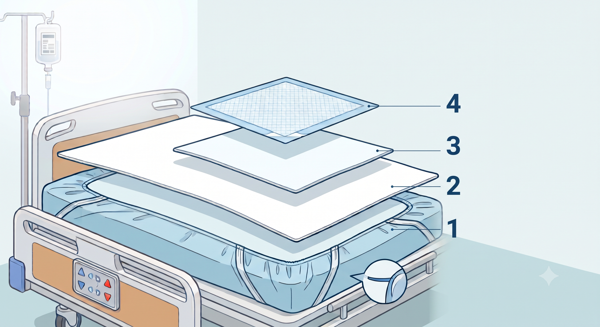

# About the Patient's Bed

Patients with limited mobility—such as those in the early stages of recovery from a brain hemorrhage—often find it hard to reach the toilet, so they wear diapers and relieve themselves in bed. When the sheets get soiled, they have to be changed over and over, so the bed needs to be set up in a way that reduces this burden.

# How to Set Up a Patient's Bed

When setting up the bed of a bedridden patient, the top priority is **how easily you can handle the patient's bodily waste**. The following approach helps with this.

## Multi-Layer Sheet Setup

Layering the sheets keeps soiling contained to the smallest possible area. The key principle is to **place smaller, easy-to-replace sheets on the upper layers, where soiling is most likely**. When soiling occurs, you only remove the affected layer, so the patient doesn't have to be moved much, and the whole set of sheets needs changing far less often—reducing discomfort for the patient and the workload for caregivers and nursing staff alike.

Arrange the sheets from bottom to top as follows.

1. **Base sheet (fitted / mattress-cover type)**: The bottom layer that covers the entire mattress. The goal of the multi-layer setup is to keep soiling from ever reaching this sheet. Replacing it is the most demanding task, since you have to move or roll the patient to change it. Use an elastic-band (fitted) type that anchors firmly to the mattress; a waterproof one is even safer.

2. **Middle sheet (full-body size)**: A rectangular flat sheet spread over the base sheet. It is the last line of defense, stopping any soiling that leaks down from the upper layers before it reaches the base sheet. Use a single-layer sheet without elastic bands so it's easy to change.

3. **Hip sheet (half sheet)**: A sheet laid only from the patient's pelvis to below the thighs. Folding a rectangular single-layer sheet into 2–4 layers improves absorbency, and its small size makes it easy to replace. Since most soiling is caught at this layer, it is the one you'll actually change most often. A folded sheet slips easily when repositioning the patient, so check its position frequently.

4. **Disposable hygiene mat (waterproof pad)**: A disposable waterproof pad placed at the very top, right under the patient's hips. It's a consumable that provides the first line of absorption for fluids that inevitably leak during diaper changes; replace it together with the diaper. Use a product with a waterproof backing so the layers below stay protected.

### Operational Tips

- When soiling occurs, remove **only from the top layer down to the soiled layer** and leave the lower layers in place. There's no need to change everything every time.
- Keeping spare sheets, hygiene mats, and plastic bags for disposing of diapers and pads near the bed at all times greatly shortens your movements—especially during nighttime changes.
- Multiple layers tend to wrinkle easily. Wrinkles pressed against the skin for long periods can cause bedsores, so always smooth everything flat after setup.
