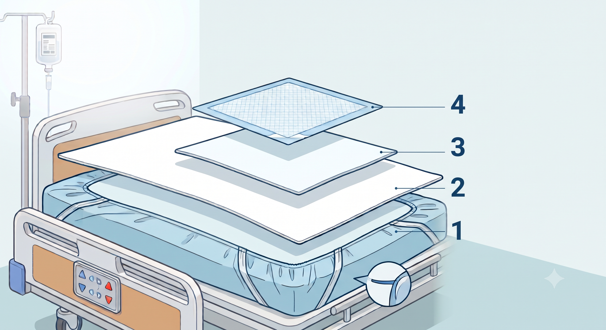

# 환자 침대에 대하여

뇌출혈 초기 등으로 거동이 불편한 환자는 화장실까지 이동하기 어려워, 기저귀를 착용하고 생리현상을 침대에서 해결하는 경우가 많습니다. 이때 시트가 오염되면 교체 작업이 반복적으로 발생하므로, 처리 부담을 줄일 수 있는 침대 세팅이 필요합니다.

# 환자 침대 세팅 방법

와상환자의 침대를 세팅할 때 가장 우선으로 고려할 점은 **생리현상 처리를 얼마나 쉽게 할 수 있는가**입니다. 이를 위해 다음 방법을 활용할 수 있습니다.

## 다중 침대 시트 구성

시트를 여러 겹으로 구성하면 생리현상 처리 시 오염 범위를 최소화할 수 있습니다. 핵심 원리는 **오염 가능성이 높을수록 위층에, 작고 교체하기 쉬운 시트를 배치**하는 것입니다. 오염이 발생하면 해당 층만 걷어내면 되므로 환자를 크게 움직일 필요가 없고, 전체 시트를 교체하는 빈도가 줄어 환자의 불편과 보호자·간호 인력의 부담이 모두 감소합니다.

시트는 아래에서 위 순서로 다음과 같이 구성합니다.

1. **기본 시트 (매트리스 커버형)**: 매트리스 전체를 덮는 가장 아래층 시트입니다. 다중 구성의 목표는 이 시트까지 오염이 도달하지 않게 하는 것입니다. 오염되면 환자를 침대에서 옮기거나 굴려가며 교체해야 해 작업 부담이 가장 큽니다. 고무줄(밴드)로 매트리스에 단단히 고정되는 타입을 사용하고, 방수 기능이 있으면 더 안전합니다.

2. **중간 시트 (전신 크기)**: 기본 시트 위에 펼쳐 덮는 직사각형 평시트입니다. 상층에서 새어 내려온 오염이 기본 시트에 닿지 않도록 막는 최후 방어선입니다. 고무줄이 없는 홑겹 시트를 사용해야 교체가 쉽습니다.

3. **엉덩이 시트 (반시트)**: 환자의 골반부터 허벅지 아래에만 까는 시트입니다. 직사각형 홑겹 시트를 2~4겹으로 접어 사용하면 흡수력이 좋아지고, 면적이 작아 교체도 수월합니다. 오염 대부분이 이 층에서 걸러지므로 실제로 가장 자주 교체하게 됩니다. 접은 시트는 체위 변경 시 밀리기 쉬우므로 위치를 수시로 확인합니다.

4. **일회용 위생매트 (방수패드)**: 가장 위, 환자 엉덩이 바로 아래에 까는 일회용 방수 패드입니다. 기저귀 교체 시 불가피하게 흐르는 체액을 1차로 흡수하는 소모품으로, 기저귀와 함께 교체합니다. 뒷면이 방수 처리된 제품을 사용해야 아래층 시트를 보호할 수 있습니다.

### 운영 팁

- 오염이 발생하면 **위층부터 오염된 층까지만** 걷어내고 아래층은 그대로 둡니다. 매번 전체를 교체할 필요가 없습니다.
- 여분 시트와 위생매트, 기저귀·패드 폐기용 비닐봉지를 침대 근처에 상시 비치하면 특히 야간 교체 시 동선이 크게 줄어듭니다.
- 시트가 여러 겹이면 주름이 생기기 쉽습니다. 주름이 장시간 눌리면 욕창의 원인이 되므로 세팅 후 반드시 평평하게 펴줍니다.
